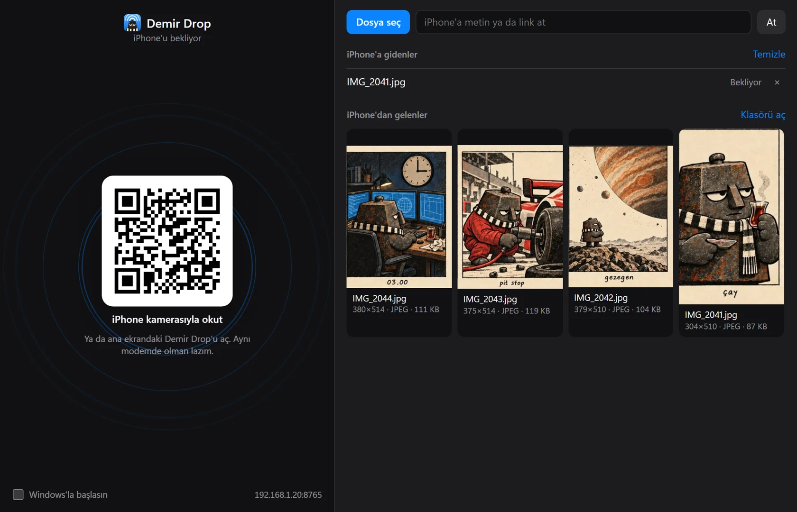

<div align="center">


# Demir Drop

**AirDrop Windows'a gelmedi. Demir geldi.**

iPhone ile Windows arasında fotoğraf, video, dosya ve metin atar.
Aynı modem yeterli. Hesap yok, bulut yok, kablo yok.

[**Tanıtım sayfası**](https://berkdemir18.github.io/Demir-Drop/) ·
[**İndir**](https://github.com/berkdemir18/Demir-Drop/releases/latest)



</div>

## Ne yapar

- **PC'den iPhone'a:** dosyaya sağ tıkla, Gönder > `iPhone'a At`. Telefonda önizlemeli Kabul Et / Reddet kartı çıkar.
- **iPhone'dan PC'ye:** sayfadan seç ya da kestirmeyle galerideki Paylaş menüsünden at. Gelenler `İndirilenler\iPhone Drop` klasörüne düşer.
- **Metin ve link:** iki yönde de. PC'ye gelen metin panoya kopyalanır.
- **Dosyaya dokunmaz:** gelen baytlar olduğu gibi yazılır. Klasör atarsan zipleyip gönderir.

iPhone'a uygulama kurulmaz, Safari yeter.

## Kurulum

1. [Son sürümden](https://github.com/berkdemir18/Demir-Drop/releases/latest) zip'i indir, aç, `DemirDrop.exe`'yi çalıştır. Kod imzası olmadığı için Windows uyarabilir: Ek bilgi > Yine de çalıştır.
2. Güvenlik duvarı iznini onayla. Yalnızca yerel ağa `8765` portunu açar.
3. Penceredeki QR'ı iPhone kamerasıyla okut. Telefon Wi-Fi'da ve PC'yle aynı modemde olmalı.

İlk açılışta masaüstü ve Gönder menüsü kısayolları oluşur.

**Paylaş menüsü ve Fotoğraflar için:** telefon sayfasında `Paylaş menüsüne ekle`ye bas, iki kestirmeyi adım adım kur.

## Bilmen gerekenler

- iPhone'un AirDrop listesinde çıkmaz, Apple dışarıdan cihaz eklettirmiyor. Paylaş menüsünde kestirme olarak çıkar.
- Bağlantı **şifresiz HTTP**. Ev gibi güvendiğin ağda kullan.
- QR'daki adres parola gibidir, paylaşma. Adresi bilmeyen 404 görür.
- Telefondaki sayfa kapalıyken PC'den atılan şey kendiliğinden ekrana düşmez, sayfayı açınca kart çıkar.
- Safari'nin dosya seçicisi HEIC fotoğrafı JPEG'e çevirebilir. Orijinal için kestirmeyi kullan.
- Modem PC'ye yeni IP verirse QR'ı yeniden okut.
- Pencere için WebView2 gerekir. Windows 11'de hazır gelir.

Bilgisayarın telefonda görünen adı `%APPDATA%\DemirDrop\ayar.json` içindeki `pc_adi`.

## Kaynaktan çalıştırma

```powershell
pip install -r requirements.txt
pythonw demirdrop.pyw
```

Test: `python -m unittest test_demirdrop` · Exe paketi: `.\derle.ps1 -Surum 1.0.0`

## Lisans

[MIT](LICENSE). Yapay zekâ desteğiyle geliştirildi.

AirDrop, Apple Inc.'in markasıdır. Bu projenin Apple'la ilgisi yoktur.
